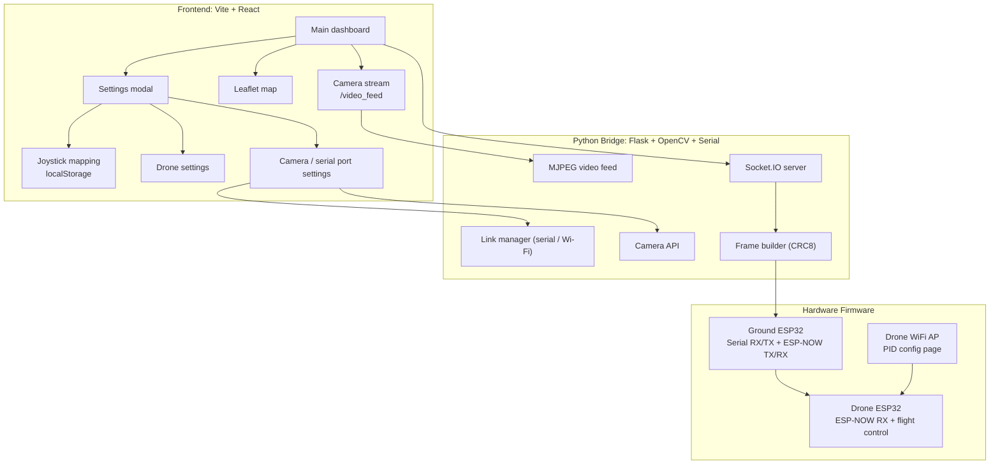
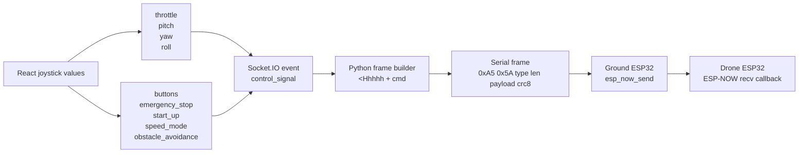
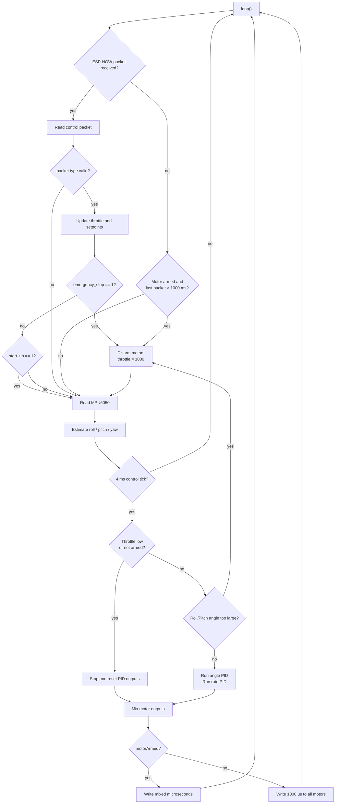
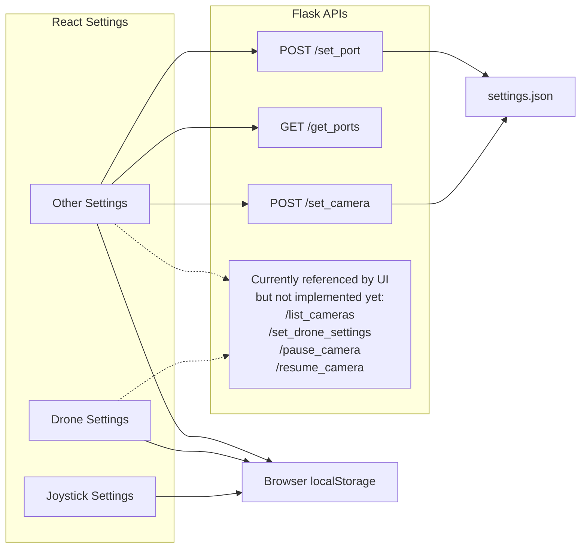

# ESP32 Drone 架構

## Overall Control Flow

```mermaid
flowchart LR
    User["Pilot"]
    Gamepad["Gamepad<br/>Browser Gamepad API"]
    React["React Control UI<br/>apps/web/src/App.tsx"]
    Socket["Socket.IO Client<br/>control_signal"]
    Flask["Python Flask + Socket.IO<br/>apps/bridge/server.py"]
    Serial["USB Serial (預設，帶 CRC 的幀)<br/>或 Wi-Fi WebSocket :81"]
    Ground["Ground ESP32<br/>hardware/ground/main.cpp"]
    NRF["ESP-NOW<br/>Channel 1"]
    Drone["Drone ESP32<br/>hardware/drone/main.cpp"]
    PID["MPU6050 + PID Control"]
    Motors["ESC / Motors<br/>FL FR BL BR"]

    User --> Gamepad
    Gamepad --> React
    React --> Socket
    Socket --> Flask
    Flask --> Serial
    Serial --> Ground
    Ground --> NRF
    NRF --> Drone
    Drone --> PID
    PID --> Motors
```

## Software Layers

## Control Signal Packet

## Drone Runtime Loop

## Settings And APIs

---

## 目前的後端模組 (`apps/bridge`)

| 模組 | 職責 |
|---|---|
| `server.py` | Flask / Socket.IO 入口，只負責路由與接線 |
| `configs.py` | `data/settings.json` 的唯一讀寫點 (thread-safe、原子寫入、舊格式自動遷移) |
| `protocol.py` | 控制封包與遙測文字格式的定義 |
| `link.py` | 與地面站的連線：`WifiLink` (WebSocket + HTTP) / `SerialLink`，可熱切換 |
| `control.py` | 固定頻率送控制、解鎖條件 (油門最低)、緊急停止、失聯自動鎖定 |
| `tuning.py` | PID 調參 / MPU 校正：解析地面站 `/tune` 表格並轉送修改指令 |
| `telemetry.py` | Geohash 解碼、航向推算、起飛點、軌跡、飛行紀錄 |
| `geohash.py` / `geo.py` | 純函式工具 |
| `camera.py` | 單一擷取執行緒 + 翻轉 / 銳化 / 灰階 + MJPEG |
| `sim.py` | GPS 模擬器 |

## HTTP / Socket.IO API

| 端點 | 說明 |
|---|---|
| `GET /settings`、`POST /settings/<section>` | 讀寫設定 (`otherSettings`、`droneSettings`、`axisMapping`、`btnMapping`、`joystickIndex`、`waypoints`) |
| `GET /video_feed`、`GET /list_cameras`、`POST /set_camera`、`/pause_camera`、`/resume_camera` | 相機 |
| `GET /get_ports`、`POST /set_port`、`GET/POST /link` | 地面站連線 |
| `GET/POST /telemetry`、`POST /home`、`POST /trail/clear`、`POST /sim` | 遙測 / GPS |
| `GET /tuning`、`POST /tuning/pid`、`POST /tuning/mpu/calibrate`、`/tuning/mpu/clear` | PID 調參與 MPU 校正 (轉送到地面站既有的 `/tune` `/update` `/mpu` `/clearMpu`，僅 Wi‑Fi 模式) |
| `GET/POST /waypoints` | 航點 |
| `GET /flights`、`GET/DELETE /flights/<id>`、`POST /flights/stop` | 飛行紀錄 |
| Socket.IO ← `control_signal` | 搖桿訊號 (前端 20 Hz) |
| Socket.IO → `telemetry` / `control_state` / `alert` | 遙測、ARM 與連線狀態、警報 |

## 尚未實作 (需要韌體配合)

* 自動返航 (Auto Return Home)、自動降落 (Auto Landing)、速度模式、避障：設定頁可以存，但韌體端還沒有對應功能。
* 發射功率 (Transmission Power)：只儲存，沒有送到韌體。
* 飛機狀態回報 (姿態、電池、解鎖確認)：飛機沒有回傳通道，PID 調參也只知道「地面站收到」，不知道飛機是否套用。
* 韌體尚未送出 GPS 資料 (見 `telemetry-protocol.md`)。

## 序列協定 (電腦 <-> 地面站 ESP32)

幀格式：`0xA5 0x5A | type | len | payload | crc8` (CRC-8 poly 0x07，範圍 type..payload)。
實作：`hardware/ground/serial_link.h` 與 `apps/bridge/protocol.py`，兩邊以 `tests/test_firmware_protocol.py` 互相驗證。

| type | 方向 | payload |
|------|------|---------|
| `0x01` CONTROL | PC → 地面站 | `<Hhhhh` throttle, roll, pitch, yaw, cmd (0 一般 / 1 ARM / 2 KILL / 3 MPU 校正 / 4 清除校正) |
| `0x02` TUNE | PC → 地面站 | `<16sfff` 軸名, P, I, D (軸名：roll/pitch/yaw/rate_roll/rate_pitch) |
| `0x03` GET_PID | PC → 地面站 | 無 |

地面站 → 電腦為文字行：`GEO,...` (遙測)、`STATUS,<地面站解鎖>,<飛機封包年齡ms>,<飛機解鎖>,<roll>,<pitch>,<電池V>` (每 0.5 秒)、`PID,<軸>,
,<i>,<d>`。

## 責任分工

* 電腦：決定「去哪、做什麼」(航點、返航、降落決策、影像)。
* 飛機：穩定控制、通訊中斷 1 秒自動停槳、本地 kill。這些不可交給電腦，因為無線連線隨時可能中斷。
* 飛機必須回報狀態 (ESP-NOW type 2 封包，欄位見 `docs/telemetry-protocol.md`)，電腦才能做決策。
